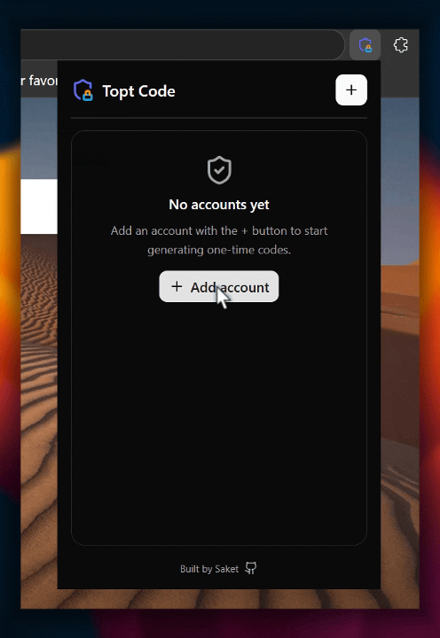

<div align="center">
  
</div>

<h1 align="center">Topt Code</h1>

<p align="center">
  <a href="https://extension.js.org" target="_blank" rel="noopener noreferrer"></a>
  
  
  
  
</p>

> [!TIP]
> Works in `Chrome`, `Edge` & `Firefox`.

> A tiny TOTP authenticator that lives in your browser toolbar. Add an account, and the popup shows its time-based one-time code, the next code, and a smooth countdown to the next refresh — copy a code with a single click.

---

> [!WARNING]
> ### Please don't use this for anything that actually matters.
>
> This is a **convenience tool**, not a secure vault. Your TOTP secrets are stored **unencrypted** in the browser's local storage, with **no master password** protecting them.
>
> Two-factor authentication only works because the second factor lives **somewhere other than** the device you log in from. If you keep your codes in the same browser on the same laptop you sign in with, you've collapsed both factors into one place — anyone who gets your laptop (theft, malware, a borrowed-and-unlocked machine) gets your password **and** your codes. That is no longer two-factor; it's one factor wearing two hats.
>
> For anything you care about — email, banking, work accounts, your password manager — use a dedicated authenticator app on a separate device. **[Proton Authenticator](https://proton.me/authenticator) is recommended** (free, open-source, end-to-end encrypted, with a proper PIN/biometric lock).
>
> Reasonable uses for Topt Code: a throwaway account, a shared test login, a CI/service token you're actively debugging — low-stakes codes where convenience beats security.

---

## 🚀 Features

- **Add accounts in seconds.** Enter a **Title**, the **Secret** (base32), and an **Issuer**. That's it.
- **Paste an `otpauth://` link.** Drop an `otpauth://totp/...` URI into the secret field and the title, issuer, digits, period, and algorithm fill in automatically.
- **Current + next code.** Each account shows its live code, plus a small preview of the one coming next.
- **Smooth countdown.** A per-account progress bar glides down in real time (pure CSS, not a stuttering timer) and turns **yellow** in the last 15s and **red** in the last 5s, with the seconds remaining beside it.
- **One-click copy.** Click a code to copy it to the clipboard.
- **Show / hide codes.** Blur every code with one toggle; the choice is remembered between sessions.
- **Edit & delete.** A per-account menu lets you edit any field or delete the account (with a confirmation step).
- **Advanced options.** Digits (6 / 7 / 8), interval (30 / 60s), and algorithm (SHA1 / SHA256 / SHA512) per account. Type is fixed to **TOTP**.
- **Cross-browser.** One codebase builds for Chromium (Chrome, Edge) and Firefox.

---

## 🌺 Tech Stack

- **Framework:** [Extension.js](https://extension.js.org) · Manifest V3
- **UI:** React 18 · TypeScript · [Base UI](https://base-ui.com) (shadcn/new-york styling)
- **TOTP:** [`totp-generator`](https://github.com/bellstrand/totp-generator)
- **Styling:** Tailwind CSS v4 · `class-variance-authority` · `lucide-react`
- **Tooling:** pnpm · PostCSS · `sharp` (icon generation)

---

## ✅ Topt Code in Action

> kindly wait for a sec to load the demo...

<div align="center">
  
</div>

---

## 🏗️ How It Works

Topt Code is intentionally simple and self-contained — there are **no content scripts** and it never touches the pages you visit.

```md
  ┌──────────────── toolbar popup (PopupApp.tsx) ─────────────────┐
  │                                                               │
  │   Add / edit dialog  ──▶  src/lib/totp.ts                     │
  │                           ─ validates + normalizes the secret │
  │                           ─ parses otpauth:// URIs            │
  │                                                               │
  │   chrome.storage.local  ◀── saves accounts (persistent)      │
  │                                                               │
  │   every second ──▶ totp-generator                            │
  │                    ─ current code + next code + expiry        │
  │                                                               │
  │   CSS keyframe countdown bar, synced to the real clock        │
  └───────────────────────────────────────────────────────────────┘
```

- **Local only.** Codes are generated in the popup with the Web Crypto API (via `totp-generator`). Nothing is sent anywhere.
- **Persistent accounts.** Accounts are saved in `chrome.storage.local` so they survive browser restarts. (See the warning above — this also means the secrets sit on disk.)
- **The one permission it asks for is `storage`.** No host access, no `tabs`, no network.

---

## 📖 Prerequisites

- **Node.js 18+**
- **pnpm** (`npm install -g pnpm`)
- A Chromium or Firefox browser

---

## ⚡ Run Locally

### 1. Install dependencies

```bash
pnpm install
```

### 2. Start development mode

Launches the browser with the extension loaded and hot-reloading enabled.

```bash
pnpm run dev                    # Chromium (default)
pnpm run dev -- --browser=firefox
pnpm run dev -- --browser=edge
```

### 3. Build for production

```bash
pnpm run build                  # Chromium (default)
pnpm run build:firefox
pnpm run build:edge
```

### 4. Preview a production build

```bash
pnpm run preview
```

---

## 🪟 Export to Windows (WSL)

For local testing, `export:win` builds the Edge bundle and copies it to your Windows Desktop so you can "Load unpacked" from a real Windows browser.

```bash
pnpm run export:win                     # Edge (default)
pnpm run export:win -- --browser=chrome # Chrome instead
```

It lands under your Desktop in a single container folder:

```txt
Desktop/programs/web-extension/
├── topt-code-edge.zip   # zipped copy for backup / transfer
└── topt-code/           # unpacked folder for "Load unpacked"
```

- **Runs from WSL or native Windows.** From WSL it copies over `/mnt/c`; on native Windows it copies directly.
- **No hard-coded user.** The Windows user is detected at runtime (via `cmd.exe` + `wslpath` under WSL), and it falls back to a OneDrive-redirected Desktop when the classic one is missing.
- **Any other OS is a no-op** — it exits with a clear message, since there's no Windows Desktop to copy to.

> [!NOTE]
> Developer mode's "Load unpacked" needs the **unpacked folder**, not the zip. The zip is only for storing or sending the build.

---

## 🖥️ Usage

1. Build or run the extension and load it in your browser.
2. Click the toolbar icon to open the popup.
3. Hit **+**, then enter a **Title**, **Secret**, and **Issuer** (or paste an `otpauth://` link). Adjust the advanced options if your service needs them.
4. The account appears in the list with its live code and a countdown.
5. **Click a code** to copy it. Use the **⋮** menu to edit or delete an account, and the **eye** toggle to hide every code.

---

## 📂 Folder Structure

```txt
.
├── scripts/
│   ├── gen-icons.mjs           # regenerate PNG icons from icon.svg
│   ├── export-to-windows.mjs   # copy a dev build to the Windows Desktop
│   └── package-release.mjs     # zip a release bundle per browser
├── src/
│   ├── background.ts           # minimal service-worker stub
│   ├── lib/
│   │   ├── totp.ts             # TOTP model, storage, otpauth parsing, code gen
│   │   └── utils.ts
│   ├── components/ui/          # Badge, Button, Card, Dialog, DropdownMenu,
│   │                           #   Input, Label, Progress, Select, Separator
│   ├── images/                 # icons (svg source + generated pngs)
│   ├── popup/
│   │   ├── PopupApp.tsx        # the entire UI
│   │   ├── scripts.tsx
│   │   ├── index.html
│   │   └── styles.css
│   └── manifest.json
├── STORE.md                    # store-submission metadata
└── package.json
```

---

## 🔒 Privacy

Topt Code collects nothing and sends nothing. There is no account, no analytics, and no server — it asks only for the `storage` permission. Your accounts and their secrets stay in `chrome.storage.local` on your own machine and never leave the browser.

That storage is **not encrypted**, and the extension has no master password. Treat it accordingly, and read the warning at the top before trusting it with anything important. See [`STORE.md`](./STORE.md) for the full data-use declaration.

---

## License

[MIT](./LICENSE) · Built by Saket · [github.com/saketV8/topt-code](https://github.com/saketV8/topt-code)
